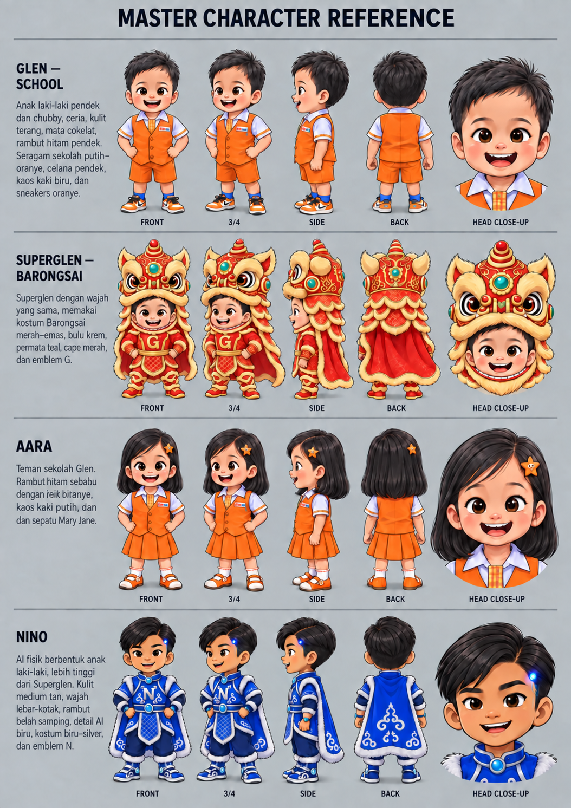
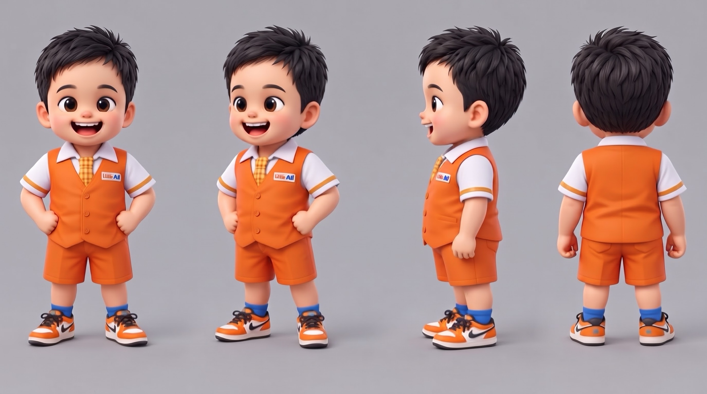
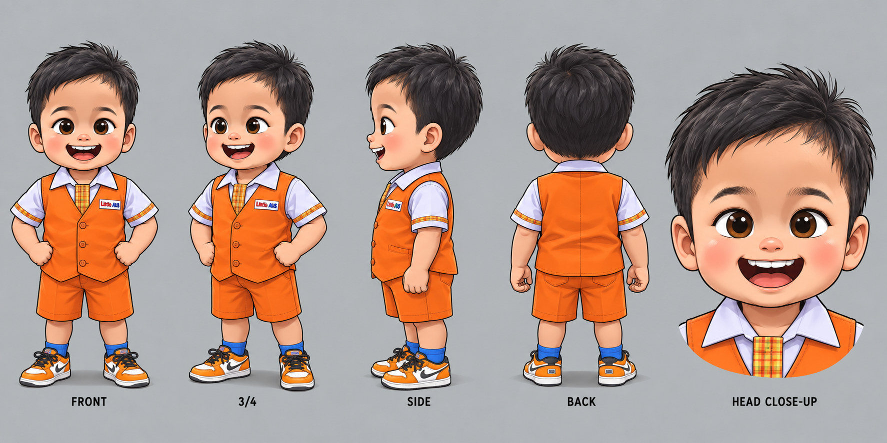
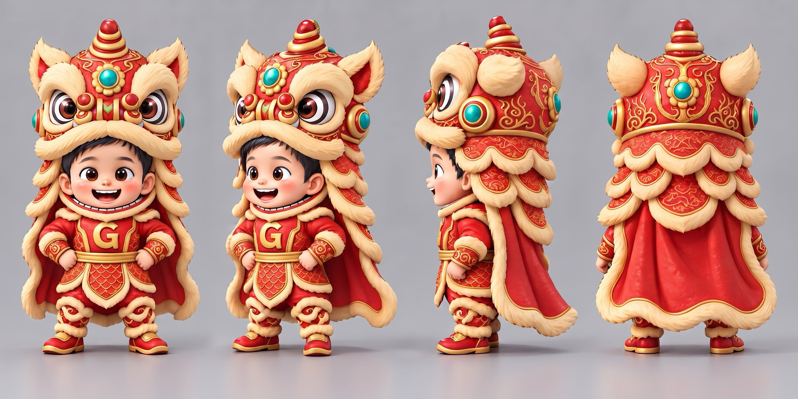
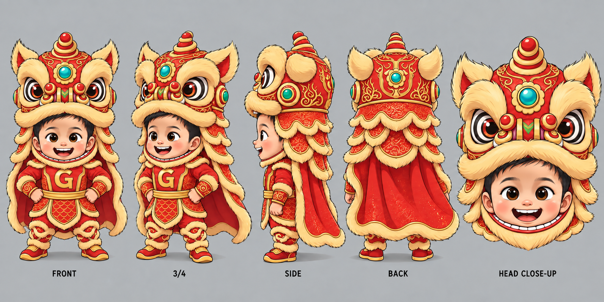
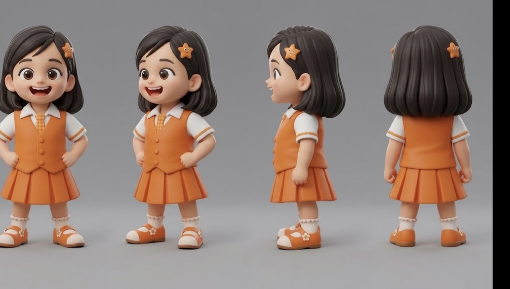
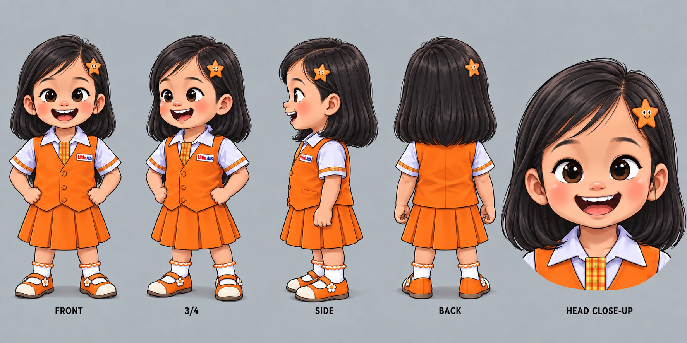
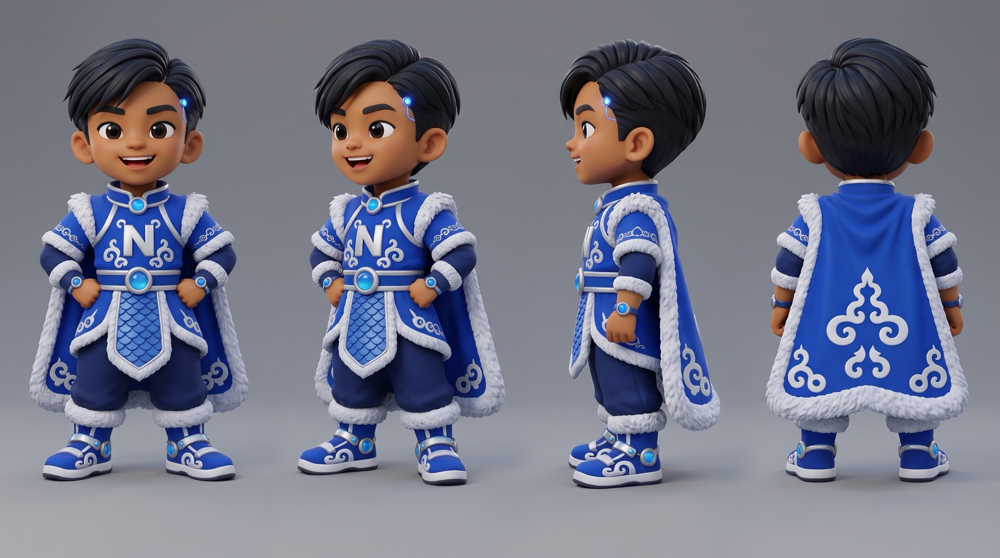
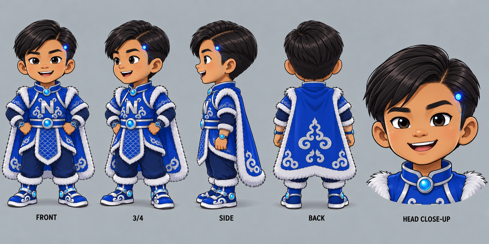

# Superglen: Pahlawan Barongsai Super (Game)

Game design doc untuk dibangun dengan Claude Code.
Pemain utama: anak usia 5 sampai 6 tahun, main di iPad/iPhone.

## 1. Ringkasan

Game 3D open world kecil di Kota Botanica. Pemain menjadi Glen, anak sekolah yang menemukan laboratorium Barongsai kuno, bertemu Nino, lalu menjadi Superglen. Cerita mengikuti komik Episode 1 sampai 4.

Prinsip yang tidak boleh dilanggar:
- Kekuatan murni teknologi, tanpa unsur mistis.
- Musuh tidak mati. Mereka dijinakkan, menyerah, atau kabur sambil lucu.
- Tidak ada game over. Kalau jatuh atau kena, Glen muncul lagi di dekat situ.
- Petunjuk lewat suara dan ikon, hampir tanpa teks (pemain belum lancar membaca).

## 1b. Aturan biaya: semua gratis

Proyek ini hanya boleh memakai tools gratis, dengan dua pengecualian yang sudah dilanggan pemilik proyek: ElevenLabs (suara) dan Higgsfield (gambar 2D). Claude Code tidak boleh menambahkan library, layanan, atau aset berbayar lainnya.

| Kebutuhan | Tool gratis | Batasan yang perlu diingat |
|---|---|---|
| Engine 3D | Three.js, Vite, TypeScript | Open source, tanpa batas |
| Fisika | Rapier | Open source |
| Model 3D dari gambar | Tripo (free tier) atau Hunyuan3D / TRELLIS di Hugging Face Spaces | Kuota bulanan terbatas, lisensi CC BY (cantumkan kredit) |
| Rapikan dan kurangi poligon | Blender | Open source |
| Rigging dan animasi | Mixamo | Gratis dengan akun Adobe |
| Suara | ElevenLabs (paket berbayar milik pemilik proyek, sudah tersambung) | Kuota mengikuti paket, lisensi komersial sudah termasuk |
| Gambar 2D (quiz, UI, sheet karakter baru, cutscene) | Higgsfield lewat MCP (langganan milik pemilik proyek) | Setiap gambar memotong kredit Higgsfield |
| Musik dan efek suara | Pixabay Music, Freesound (CC0), Kenney.nl | Pilih yang berlisensi CC0 |
| Aset kota low-poly | Kenney.nl, Quaternius, Poly Pizza (CC0) | Gratis |
| Hosting | GitHub Pages atau Cloudflare Pages | Gratis |
| Main di iPad/iPhone | PWA lewat Safari "Add to Home Screen" | Tidak perlu App Store |

**Kalau suatu saat mau dijual atau dipublikasikan di App Store**, beberapa hal ini berubah jadi berbayar: akun Apple Developer, dan kemungkinan lisensi model 3D tanpa atribusi. Untuk dimainkan keluarga sendiri, semuanya cukup gratis.

**Suara**
- Semua karakter, soal quiz, dan narasi dibuat dengan ElevenLabs.
- Opsional: keluarga bisa merekam suara sendiri untuk beberapa kalimat. Taruh di `public/audio/{id}.mp3` dengan id yang sama dan tandai `"source": "recorded"` di dialog.json supaya tidak ditimpa.
- Tetap lewati file yang sudah ada saat generate ulang, supaya kuota bulanan tidak terbuang.

**Gambar 2D lewat Higgsfield MCP**

Instruksi untuk Claude Code:
- Server MCP resmi: `https://mcp.higgsfield.ai/mcp` (login OAuth dengan akun Higgsfield, tanpa API key).
- Selalu lampirkan gambar acuan dari folder `art/reference/` (Master Character Reference dan turnaround sheet 3D) supaya gaya tetap konsisten: chibi 3D, warna cerah, latar abu polos.
- Kebutuhan gambar:
  - Sheet karakter baru (turnaround front, 3/4, side, back) untuk semua minion, mini-boss, dan Raja Tikus Rakus, dengan gaya yang sama persis seperti Glen dan Nino. Hasilnya lalu diubah jadi model 3D lewat Tripo.
  - Gambar soal quiz: hewan, buah, benda, tempat (rumah, sekolah, bank, rumah sakit). Satu objek per gambar, latar putih polos, gaya kartun 3D yang sama.
  - Ikon tombol (lompat, laser, perisai), ikon app, stiker koleksi.
  - Gambar cutscene pendek untuk awal dan akhir tiap bab.
- Hemat kredit: buat dulu 1 contoh per kategori, minta persetujuan pemilik proyek, baru buat sisanya. Simpan semua hasil di `art/generated/` dengan nama file yang jelas, dan catat prompt-nya di `art/prompts.md` supaya bisa dibuat ulang.
- Jangan buat gambar dengan teks di dalamnya. Teks ditambahkan di game.

## 2. Platform dan teknologi

- Engine: Three.js + Vite + TypeScript
- Fisika: Rapier (@dimforge/rapier3d-compat)
- Model 3D: format GLB, low-poly, gaya chibi
- Target: browser di PC (Chrome, Edge, Safari, Firefox) dan iPhone/iPad (Safari), 60 fps di PC, minimal 30 fps stabil di iPhone, orientasi landscape
- Satu kode untuk semua perangkat. Kontrol dan kualitas grafis menyesuaikan otomatis.
- Tahap 2: jadikan PWA (Progressive Web App) supaya bisa dipasang di layar utama iPad/iPhone lewat Safari "Add to Home Screen", tampil layar penuh dan bisa dimainkan offline. Gratis, tanpa akun Apple Developer.
- Hosting: GitHub Pages atau Cloudflare Pages (gratis).
- Simpan progres: localStorage (dibungkus try/catch)

## 3. Karakter (acuan: Master Character Reference)

**Game ini 100% 3D** (open world 3D seperti Goat Simulator dan Spider-Man, kamera orang ketiga). Gambar di bawah hanya acuan desain karakter untuk membuat model 3D, bukan aset yang dipakai langsung di game. Versi render 3D adalah acuan utama. Versi ilustrasi 2D hanya cadangan untuk detail wajah dan ekspresi, dan tidak boleh dipakai sebagai sprite.



| Karakter | Render 3D (acuan utama) | Ilustrasi 2D |
|---|---|---|
| Glen |  |  |
| Superglen |  |  |
| Aara |  |  |
| Nino |  |  |

**Glen (mode sekolah)**
Anak laki-laki pendek dan chubby, ceria, kulit terang, mata cokelat besar, rambut hitam pendek berantakan. Kemeja putih, rompi oranye dengan badge nama, dasi kotak kuning, celana pendek oranye, kaos kaki biru, sneakers oranye-putih.
Kemampuan: jalan, lari, lompat kecil, naik sepeda, ngobrol.

**Superglen (mode pahlawan)**
Wajah Glen yang sama, memakai kepala Barongsai merah-emas (mata besar bergaris, permata teal di dahi, bulu krem), baju merah dengan emblem G emas, sabuk emas, sisik naga di depan, cape merah berbulu krem, sepatu merah-emas.
Kemampuan inti (4 skill):
- **Lompat Barongsai:** lompatan tinggi dengan gaya Barongsai, kepala singa mengangguk dan cape berkibar saat di udara. Tekan lagi di udara untuk lompatan kedua (double jump) dengan putaran. Saat mendarat ada hentakan kecil yang membuat minion di dekatnya pusing berbintang. Bisa dipakai untuk naik ke atap dan tiang tinggi, seperti atraksi Barongsai di atas tiang.
- **Perisai cahaya:** kubah cahaya emas di depan Superglen, memantulkan lemparan musuh. Di level boss bisa berubah menjadi jaring cahaya.
- **Laser tangan:** sinar dari pergelangan tangan, dengan bidikan otomatis ke musuh terdekat.
- **Terbang:** jet booster, tahan tombol Lompat di udara lebih lama. Bisa terbang bebas di atas kota.

**Nino (AI penjaga laboratorium)**
AI berbentuk anak laki-laki, sedikit lebih tinggi dari Glen. Kulit medium tan, rambut belah samping, titik lampu biru di pelipis dengan garis sirkuit. Kostum biru-silver dengan emblem N, bulu putih, cape biru bermotif awan silver, permata biru di dada dan sabuk.
Peran: pemandu dan pelatih. Semua instruksi game keluar dari suara Nino.

**Aara (sahabat sekolah Glen)**
Anak perempuan, rambut hitam sebahu, jepit bintang oranye. Seragam sama dengan Glen tapi rok lipit oranye, kaos kaki putih berenda, sepatu Mary Jane oranye.
Peran: teman di mode sekolah, partner penyelidik di Bab 4.

**Si Tikus Rakus (boss Bab 3)**
Tikus raksasa yang lucu, rakus, suka mencuri makanan pasar. Dijinakkan dengan jaring cahaya, lalu menyerah.
Minion: tikus-tikus kecil pencuri makanan.

**Sosok Misterius (Bab 4)**
Berjubah gelap dengan lambang teknologi asing. Belum bisa dilawan, hanya muncul dan menghilang.

## 4. Kontrol (layar sentuh)

- Kiri bawah: joystick virtual untuk bergerak
- Kanan bawah: maksimal 2 tombol besar
  - Mode Glen: Lompat, Bicara/Ambil
  - Mode Superglen: Lompat Barongsai, Laser, Perisai (tiga tombol, susun melengkung di kanan bawah)
- Lompat Barongsai: ketuk sekali untuk lompat, ketuk lagi di udara untuk double jump
- Terbang: tahan tombol Lompat lebih dari 1 detik di udara, lepas untuk turun pelan
- Tombol Berubah: muncul otomatis saat alarm berbunyi atau di lab
- Kamera mengikuti otomatis, bisa diputar dengan geser jari di area kosong
- Tombol minimal 80 x 80 pt, ikon jelas, tanpa tulisan

**Kontrol di PC (otomatis aktif kalau tidak ada layar sentuh)**
- WASD atau panah: bergerak
- Mouse: putar kamera (klik di layar untuk mengunci kursor, Esc untuk melepas)
- Spasi: Lompat Barongsai (tekan lagi di udara untuk double jump, tahan untuk terbang)
- Klik kiri atau J: Laser
- Klik kanan atau K: Perisai
- E: bicara, ambil, berubah jadi Superglen
- Angka 1, 2, 3: pilih jawaban Tantangan Pintar (bisa juga klik)
- Gamepad (opsional): didukung lewat Gamepad API

**Kualitas grafis otomatis**
- PC: bayangan dan efek penuh, jarak pandang jauh.
- iPhone: bayangan sederhana, jarak pandang lebih pendek, resolusi render disesuaikan supaya tetap lancar dan tidak panas.

## 5. Struktur cerita (Bab)

**Bab 1: Komputer Kuno Barongsai** (eksplorasi)
1. Glen pulang sekolah di jalan kota (tutorial jalan dan lompat).
2. Melihat gedung Barongsai tua, ada cahaya dari dalam.
3. Masuk lewat celah pagar, jalan di gedung gelap dengan senter HP.
4. Sentuh panel sirkuit, dinding terbuka, masuk ke laboratorium.
5. Tekan tombol besar di komputer berbentuk kepala Barongsai.
6. Nino muncul: "Sistem aktif. Halo." lalu "Aku Nino. Kamu terpilih karena hatimu, Glen."
7. Kostum keluar dari kompartemen. Glen memakainya. "Aku jadi Superglen!"
8. Penutup lucu: semua fitur kostum menyala bersamaan.

**Bab 2: Latihan Pagi Bersama Nino** (tutorial kekuatan)
1. Jet booster: percobaan pertama nabrak langit-langit (animasi lucu, otomatis). Lalu terbang melewati 5 cincin cahaya.
2. Laser tangan: tembak 5 sasaran. Kalau meleset, Nino: "Tenang dulu, baru bidik." Bidikan dibantu otomatis (auto-aim).
3. Perisai: Nino melempar bola karet, pemain tekan Perisai. Blok 5 bola.
4. Istirahat makan bekal bersama Nino (adegan singkat).
5. Alarm berbunyi, layar menampilkan pasar kota.

**Catatan cerita:** di komik Episode 3 Si Tikus Rakus langsung menyerah. Di game, dia kabur di Bab 3 dan menjadi **Raja Tikus Rakus**, boss terakhir. Sepanjang game, pasukannya membuat kekacauan di berbagai tempat di Kota Botanica, dan Superglen makin kuat di setiap bab.

**Bab 3: Pasar Kacau!** (pertarungan pertama)
1. Terbang ke pasar, kejar 6 sampai 8 Tikus Kecil yang mencuri makanan.
2. Tantangan Pintar: hitung bakpao dan kue yang dikembalikan ke pedagang.
3. Si Tikus Rakus muncul, tertawa "Hihihi, semua makanan ini milikku!", lalu kabur ke gorong-gorong. "Suatu hari aku akan jadi RAJA kota ini!"
4. Penutup: sosok misterius terlihat di bayangan.

**Bab 4: Sosok Misterius** (mode detektif, tanpa pertarungan)
1. Mode Glen di sekolah bersama Aara.
2. Mencari petunjuk di taman kota dengan membaca papan dan kata.
3. Sosok Misterius muncul: "Aku sudah lama mengawasimu... Superglen." lalu menghilang.
4. Nino menemukan bahwa pasukan tikus memakai alat curian dari lab lama. Misi berikutnya dimulai.

**Bab 5: Bekal Hilang di Sekolah** (xué xiào)
- Minion: Tikus Kecil dan Tikus Pelempar (melempar kulit pisang).
- Mini-misi: kembalikan 5 kotak bekal ke teman-teman sekelas.
- Mini-boss: **Kapten Kunyah**, tikus gendut yang memakan semua bekal. Pola: berguling ke arah Superglen, pemain melompat dengan Lompat Barongsai, lalu tembak laser saat dia pusing.

**Bab 6: Balon Tikus di Taman**
- Minion: Tikus Balon (melayang, hanya bisa dikejar dengan terbang).
- Mini-misi: selamatkan 3 hewan tersesat (Tantangan tebak hewan dari suara).
- Mini-boss: **Tikus Zeppelin**, balon besar berisi tikus. Pemain terbang dan menembak 3 tali balon, sambil memakai perisai untuk menangkis biji kacang yang dijatuhkan.

**Bab 7: Koin Emas di Bank** (yín háng)
- Minion: Tikus Helm Panci (bagian depan kebal laser, harus dilompati dulu lalu ditembak dari belakang).
- Mini-misi: kumpulkan koin emas yang berceceran, lalu jawab "berapa koin yang kamu kumpulkan?"
- Mini-boss: **Tikus Brankas**, tikus di dalam robot brankas. Titik lemahnya permata yang menyala di punggung, hanya terlihat setelah dia menabrak tiang.

**Bab 8: Kekacauan di Rumah Sakit** (yī yuàn)
- Misi penyelamatan, sedikit pertarungan: Tikus Kecil mengganggu dapur rumah sakit.
- Mini-misi: antar makanan dan kursi roda ke ruangan yang benar dengan membaca nomor dan kata di pintu.
- Mini-boss: **Tikus Kilat**, sangat cepat. Pemain menunggu dia berhenti, lalu memasang perisai untuk menghentikannya.

**Bab 9: Menuju Sarang Raja** (gorong-gorong dan gudang tua)
- Level panjang gabungan semua skill: Lompat Barongsai di atas tiang dan pipa, terbang melewati lorong, perisai menahan air yang menyembur.
- Gelombang minion campuran dari semua jenis.
- Aara membawa alat penerjemahnya untuk membuka pintu sarang (Tantangan bahasa Inggris dan Mandarin).
- Nino menyelesaikan perbaikan kostum: semua skill di level maksimal.

**Bab 10: Raja Tikus Rakus** (boss terakhir)
Raja Tikus Rakus memakai mahkota makanan dan duduk di singgasana dari tumpukan barang curian. 4 fase:
- Fase 1: melempar buah dan kue, pemain menangkis dengan perisai.
- Fase 2: memanggil gelombang minion, pemain membersihkan arena dengan laser dan hentakan Lompat Barongsai.
- Fase 3: singgasana terbang ke atas, pemain terbang mengejar dan menembak titik lemah di mahkota.
- Fase 4: Raja kelelahan, butuh kode jaring cahaya. Nino: "Isi kodenya, Glen!" (soal berhitung). Jawaban benar memicu jaring cahaya raksasa.
- Akhir: Raja Tikus Rakus menyerah: "Baik, baik, aku menyerah!" Dia minta maaf, lalu ikut membagikan semua makanan curian ke warga. Pesta besar di alun-alun Kota Botanica dengan atraksi Barongsai. Kepingan memori ilmuwan terakhir terbuka sebagai teaser petualangan berikutnya.

## 6. Dunia: Kota Botanica

Kecil tapi padat, bisa dijelajahi bebas setelah Bab 1.
- Sekolah Glen dan Aara (halaman, lapangan, pohon besar)
- Jalan kota dan rumah-rumah
- Gedung Barongsai tua (pintu masuk lab rahasia)
- Laboratorium bawah tanah (layar biru keemasan, komputer kepala Barongsai)
- Pasar tradisional (kios buah, sayur, kue)
- Taman kota (semak, kolam, bangku)

Gaya: low-poly, warna cerah, merah-emas-oranye sebagai warna utama, langit pagi ceria.

Aktivitas bebas di open world:
- Naik sepeda keliling kota (mode Glen)
- Terbang di atas kota (mode Superglen)
- Kumpulkan koin emas berbentuk kepala Barongsai
- Bantu warga: kucing di atas pohon, balon terbang, barang jatuh

## 7. Tantangan Pintar Nino (quiz persiapan SD)

Quiz ringan untuk anak menuju masuk SD. Dibungkus sebagai "Tantangan Pintar" dari Nino, supaya terasa bagian dari petualangan, bukan pelajaran.

**Di mana muncul**
- Terminal Nino (layar biru kecil) tersebar di kota dan lab. Superglen mendekat, layar menyala.
- Sebelum membuka pintu lab atau peti harta, Nino bilang: "Kunci ini butuh jawaban pintar!"
- Satu tantangan berisi 3 soal saja. Selesai dapat koin Barongsai dan stiker.

**Aturan main (sangat ringan)**
- Setiap soal dibacakan suara Nino. Anak tidak perlu bisa membaca untuk menjawab, kecuali kategori Membaca.
- Pilihan jawaban selalu 3, berupa gambar besar.
- Jawaban salah: kartu bergoyang lucu, Nino bilang "Hampir! Coba lagi," lalu pilihan yang salah menghilang. Tidak ada nilai merah, tidak ada hukuman.
- Jawaban benar: kembang api kecil, suara tambur Barongsai, Nino bilang "Hebat, Glen!"
- Tingkat kesulitan naik pelan sesuai jawaban benar, turun lagi kalau anak sering salah.

**Kategori dan contoh soal**

1. **Berhitung (penjumlahan dasar)**
   - Level 1: hitung benda. "Ada berapa apel?" (1 sampai 5)
   - Level 2: tambah dengan gambar. 2 bakpao + 1 bakpao = ?
   - Level 3: angka sampai 10. 3 + 4 = ?
   - Gambar benda selalu ditampilkan, supaya anak bisa menghitung satu per satu dengan jari.

2. **Bahasa Inggris**
   - "Apa bahasa Inggrisnya kucing?" Pilihan: cat, dog, bird (dibacakan semua).
   - Atau kebalikannya: Nino bilang "Apple!", anak pilih gambar apel.
   - Tema kata: hewan, buah, warna, anggota keluarga, benda di sekolah.

3. **Mandarin**
   - Salam: nǐ hǎo (halo), xiè xie (terima kasih), zài jiàn (sampai jumpa).
   - Angka 1 sampai 10: yī, èr, sān, ...
   - Warna dan hewan: hóng (merah), shī zi (singa).
   - Nama tempat: jiā (rumah), xué xiào (sekolah), yín háng (bank), yī yuàn (rumah sakit). Semua tempat ini ada di Kota Botanica, jadi bisa dipakai untuk navigasi misi.
   - Format: Nino mengucapkan kata Mandarin, anak pilih gambar yang cocok.
   - Cocok sekali dengan tema Barongsai, misalnya "Barongsai warnanya hóng sè, artinya... merah!"
   - Catatan: audio Mandarin dibuat dengan ElevenLabs. Pakai model multilingual, tulis teks dalam aksara Han (家, 学校, 银行, 医院) bukan pinyin, lalu cek nadanya ke penutur asli sebelum dipakai.

4. **Tebak Hewan**
   - Dengar suara hewan, pilih gambar hewannya.
   - Lihat bayangan hitam (siluet), tebak hewannya.
   - Tebak dari petunjuk: "Aku punya belalai panjang. Siapa aku?"

5. **Membaca**
   - Level 1: kenal huruf. "Mana huruf B?"
   - Level 2: suku kata. Ba, bi, bu, be, bo. Anak pilih suku kata yang dibacakan.
   - Level 3: kata pendek dengan gambar. Tulisan "bola", pilih gambar bola. Lalu "buku", "susu", "kucing".
   - Huruf besar, font huruf kecil yang ramah anak (seperti di buku pelajaran TK), jarak antar huruf lega.

**Tantangan sebagai bagian cerita**

Prinsipnya: setiap jawaban benar membuat sesuatu terjadi di dunia game. Quiz bukan jeda, tapi cara Superglen menyelesaikan masalah.

1. **Energi Pintar untuk kostum.** Kostum Superglen ditenagai Energi Pintar dari komputer kuno. Di awal, hanya Lompat Barongsai yang aktif. Laser, perisai, dan terbang terbuka satu per satu setelah anak menyelesaikan Tantangan Pintar di lab (Bab 2). Ini cocok dengan cerita latihan bersama Nino.
2. **Misi navigasi Mandarin.** Nino menerima laporan: "Ada yang butuh bantuan di yī yuàn!" Anak harus memilih tempat yang benar dari 3 gambar, lalu panah menuntun Superglen terbang ke rumah sakit. Hal yang sama untuk jiā, xué xiào, dan yín háng.
3. **Berhitung di misi pasar (Bab 3).** Setelah tikus kecil kabur, pedagang bilang: "Bakpaoku hilang 3, kue hilang 2." Anak mengumpulkan jumlah yang tepat lalu menjawab "Totalnya berapa?" untuk mengembalikan semuanya.
4. **Kelemahan boss.** Di fase terakhir Si Tikus Rakus, jaring cahaya butuh kode. Nino: "Isi kodenya, Glen! 2 + 2?" Jawaban benar langsung memicu jaring cahaya.
5. **Penyelamatan hewan.** Hewan tersesat tersebar di kota. Suara hewan terdengar dari balik semak atau atap. Anak menebak hewannya, lalu Superglen menyelamatkannya dengan Lompat Barongsai. Hewan yang diselamatkan pindah ke "Taman Hewan" di dekat lab dan bisa dikunjungi.
6. **Membaca papan petunjuk.** Di Bab 4 (mode detektif), petunjuk tertulis di papan dan kertas: "bola", "pohon", "kolam". Anak membaca kata, lalu tempat itu berkilau dan petunjuk berikutnya muncul.
7. **Kata Inggris dari Aara.** Aara membuat alat penerjemah. Di mode sekolah, Aara minta bantuan menguji alatnya: "Glen, apa bahasa Inggrisnya buku?" Setiap jawaban benar membuat alat Aara makin canggih, dan di Bab 4 alat itu dipakai untuk melacak sinyal Sosok Misterius.
8. **Kepingan memori ilmuwan.** Di Episode 2, Nino bilang data ilmuwan masih terkunci. Setiap 5 Tantangan Pintar membuka satu kepingan foto atau pesan suara ilmuwan yang hilang. Ini menjadi alasan jangka panjang untuk terus bermain, dan menyambung ke misteri Episode 5.

**Hadiah**
- Koin Barongsai untuk membeli aksesori kostum (warna cape, efek laser).
- Stiker koleksi di album, satu halaman per kategori.
- Kepingan memori ilmuwan.

**Bank soal**
Disimpan dalam satu file data (JSON) per kategori, supaya mudah ditambah tanpa mengubah kode. Target awal: 20 soal per kategori.

**Untuk orang tua**
Halaman kecil tersembunyi (tekan lama logo 3 detik) berisi ringkasan: kategori mana yang sudah lancar dan mana yang masih sering salah.

## 8. Musuh

| Musuh | Level | Muncul | Perilaku | Cara menjinakkan |
|---|---|---|---|---|
| Tikus Kecil | Rendah | Bab 3 dst | Lari membawa makanan | 1 laser atau hentakan, kabur |
| Tikus Pelempar | Rendah | Bab 5 dst | Melempar kulit pisang dari jauh | Perisai, lalu laser |
| Tikus Balon | Sedang | Bab 6 dst | Melayang di udara | Terbang, lalu laser |
| Tikus Helm Panci | Sedang | Bab 7 dst | Depan kebal laser | Lompati, tembak dari belakang |
| Kapten Kunyah | Mini-boss | Bab 5 | Berguling | Lompat, lalu laser saat pusing |
| Tikus Zeppelin | Mini-boss | Bab 6 | Menjatuhkan kacang dari balon | Terbang, putus 3 tali |
| Tikus Brankas | Mini-boss | Bab 7 | Robot brankas menabrak | Tembak permata di punggung |
| Tikus Kilat | Mini-boss | Bab 8 | Sangat cepat | Perisai saat dia berhenti |
| Raja Tikus Rakus | Boss terakhir | Bab 10 | 4 fase | Jaring cahaya dengan kode |
| Sosok Misterius | Cerita | Bab 3, 4 | Muncul lalu hilang | Tidak dilawan |

Setiap mini-boss punya satu pola sederhana yang diulang dan diumumkan oleh Nino ("Dia mau berguling, lompat, Glen!"). Darah mini-boss ditampilkan sebagai 3 bintang, bukan bar angka.

Saat kena: efek bintang dan suara "boing", bukan darah atau ledakan.

## 9. Suara dan dialog (ElevenLabs)

Dialog muncul sebagai balon besar dengan ikon wajah karakter, teks pendek sebagai pelengkap. Musik ceria, sentuhan perkusi Barongsai (tambur, simbal) saat berubah dan saat boss.

### Instruksi untuk Claude Code: pipeline audio ElevenLabs

**Cara utama: ElevenLabs MCP.** Akun ElevenLabs pemilik proyek sudah tersambung ke Claude. Kalau tools ElevenLabs (MCP) tersedia di sesi Claude Code:
- Pakai tool text-to-speech dari MCP untuk membuat audio, dengan voice ID dan teks dari `audio/voices.json` dan `audio/dialog.json`.
- Simpan setiap hasil sebagai `public/audio/{id}.mp3`, lalu catat di `audio/manifest.json`.
- Aturan lain di bawah (lewati file yang sudah ada, aksara Han untuk Mandarin, jangan timpa rekaman sendiri) tetap berlaku.
- Untuk batch besar (puluhan kalimat sekaligus), pakai script di bawah supaya lebih cepat dan bisa diulang.

**Cara cadangan: script dengan API key**, kalau MCP tidak tersedia atau untuk generate massal.

Semua audio dibuat **sekali saat development**, disimpan sebagai MP3 di proyek, lalu diputar dari file. Game tidak boleh memanggil API ElevenLabs saat dimainkan (supaya offline, cepat, dan API key tidak bocor ke browser).

**1. API key**
- Simpan di file `.env` di root proyek: `ELEVENLABS_API_KEY=...`
- Tambahkan `.env` ke `.gitignore`. Jangan pernah memasukkan key ke kode frontend.

**2. Daftar suara karakter: `audio/voices.json`**
```json
{
  "glen":   { "voice_id": "ISI_VOICE_ID", "stability": 0.4, "similarity_boost": 0.8, "style": 0.5 },
  "nino":   { "voice_id": "ISI_VOICE_ID", "stability": 0.6, "similarity_boost": 0.8, "style": 0.3 },
  "aara":   { "voice_id": "ISI_VOICE_ID", "stability": 0.4, "similarity_boost": 0.8, "style": 0.5 },
  "tikus":  { "voice_id": "ISI_VOICE_ID", "stability": 0.3, "similarity_boost": 0.7, "style": 0.8 },
  "warga":  { "voice_id": "ISI_VOICE_ID", "stability": 0.5, "similarity_boost": 0.7, "style": 0.3 },
  "mandarin": { "voice_id": "ISI_VOICE_ID", "stability": 0.7, "similarity_boost": 0.8, "style": 0.0 }
}
```
Voice ID diambil dari Voice Library di dashboard ElevenLabs (atau suara hasil clone). Pemilik proyek yang mengisinya.

**3. Daftar kalimat: `audio/dialog.json`**
Setiap kalimat punya id unik. Id ini yang dipanggil dari kode game.
```json
[
  { "id": "bab1_nino_halo", "speaker": "nino", "lang": "id", "text": "Sistem aktif. Halo." },
  { "id": "bab1_nino_terpilih", "speaker": "nino", "lang": "id", "text": "Aku Nino. Kamu terpilih karena hatimu, Glen." },
  { "id": "quiz_benar_1", "speaker": "nino", "lang": "id", "text": "Hebat, Glen!" },
  { "id": "quiz_mandarin_yiyuan", "speaker": "mandarin", "lang": "zh", "text": "医院" },
  { "id": "quiz_inggris_cat", "speaker": "nino", "lang": "en", "text": "Cat!" }
]
```
Soal quiz di bank soal JSON merujuk ke id audio ini (field `audio_id`).

**4. Script generator: `scripts/generate-audio.mjs`** (Node 18+, jalankan dengan `npm run audio`)
- Baca `voices.json` dan `dialog.json`.
- Untuk setiap kalimat, panggil:
  `POST https://api.elevenlabs.io/v1/text-to-speech/{voice_id}?output_format=mp3_44100_128`
  Header: `xi-api-key: <ELEVENLABS_API_KEY>`, `Content-Type: application/json`
  Body: `{ "text": "...", "model_id": "eleven_multilingual_v2", "language_code": "<lang>", "voice_settings": { "stability": ..., "similarity_boost": ..., "style": ... } }`
- Simpan hasilnya ke `public/audio/{id}.mp3`.
- **Lewati** file yang sudah ada, kecuali dijalankan dengan `--force` atau `--only=<id>`. Simpan hash teks di `audio/manifest.json`, dan buat ulang otomatis kalau teks kalimat berubah. Ini menghemat kuota karakter ElevenLabs.
- Sebelum mulai, cek sisa kuota lewat `GET https://api.elevenlabs.io/v1/user/subscription`. Hitung total karakter yang akan dibuat; kalau melebihi sisa kuota, buat sebanyak yang muat lalu berhenti dengan pesan jelas.
- Lewati kalimat dengan `"source": "recorded"`.
- Jeda 300 ms antar request, dan coba ulang maksimal 3 kali kalau dapat error 429 (rate limit).
- Di akhir, cetak ringkasan: berapa dibuat, dilewati, gagal, dan total karakter terpakai.
- Cek dokumentasi terbaru di https://elevenlabs.io/docs sebelum menulis script, karena nama model dan parameter bisa berubah.

**5. Aturan Mandarin**
- Teks ditulis dalam aksara Han (医院, 银行, 学校, 家), bukan pinyin, dengan `language_code: "zh"`.
- Pinyin tetap ditampilkan di layar sebagai teks bantu, tapi tidak dikirim ke ElevenLabs.
- Setelah dibuat, nadanya dicek ke penutur asli sebelum rilis.

**6. Di dalam game**
- Buat modul `AudioManager` yang memuat file dari `public/audio/` berdasarkan id, dengan preload per bab.
- Di iOS Safari audio baru boleh diputar setelah sentuhan pertama. Tampilkan layar "Ketuk untuk mulai" di awal untuk membuka audio.
- Kalau file audio belum ada, tampilkan teksnya saja dan catat id yang hilang di console. Game tidak boleh berhenti.

## 10. Aset 3D

Acuan: turnaround sheet versi render 3D (front, 3/4, side, back) untuk Glen, Superglen, Aara, dan Nino. Versi 3D ini lebih cocok untuk image-to-3D dibanding versi ilustrasi 2D. Versi terbaru sudah tanpa podium dan label. Sebelum diproses, potong tiap pose jadi gambar sendiri. Catatan: sheet Aara terpotong di sisi kiri dan ada bar hitam di kanan, jadi untuk Aara pakai pose 3/4, side, dan back, atau buat ulang sheet-nya.
Jalur produksi yang disarankan:
1. Ubah turnaround sheet jadi model 3D dengan tool image-to-3D gratis: Tripo (free tier) atau Hunyuan3D / TRELLIS di Hugging Face Spaces. Hemat kuota: buat 4 karakter utama dulu, minion dan boss menyusul.
   Rapikan di Blender.
2. Rigging dan animasi dasar (idle, jalan, lari, lompat, terbang) lewat Mixamo.
3. Kurangi poligon supaya ringan di iPhone (target di bawah 15 ribu segitiga per karakter).
4. Ekspor GLB.

Selama aset belum siap, gunakan placeholder berbentuk kapsul berwarna (oranye untuk Glen, merah untuk Superglen, biru untuk Nino) supaya gameplay bisa dites duluan.

## 11. Urutan build untuk Claude Code

**Milestone 1: Fondasi**
Proyek Vite + Three.js + Rapier. Satu area datar, karakter kapsul, joystick virtual, kamera ikut, tombol lompat. Dites di Safari iPad.

**Milestone 2: Bab 1**
Jalan kota sederhana, gedung tua, laboratorium, interaksi panel dan tombol, Nino dengan dialog suara, transformasi ke Superglen.

**Milestone 3: Bab 2**
Lompat Barongsai (double jump + hentakan mendarat) di tiang-tiang latihan, jet booster dan cincin, laser dan sasaran dengan auto-aim, perisai dan bola karet.

**Milestone 3b: Tantangan Pintar**
Sistem quiz dengan bank soal JSON, 5 kategori, 3 pilihan gambar, suara Nino. Pasang 1 terminal di lab sebagai uji coba.

**Milestone 3c: Pipeline audio**
Script ElevenLabs, voices.json, dialog.json, AudioManager. Buat audio untuk Bab 1 dan 2 dulu.

**Milestone 4: Bab 3, Pasar Kacau**
Pasar, Tikus Kecil, misi berhitung bakpao, Si Tikus Rakus kabur.

**Milestone 5: Model asli dan polesan**
Ganti kapsul dengan model GLB, animasi, musik, efek.

**Milestone 6: Open world dan Bab 4**
Kota lengkap, sepeda, koin, misi kecil warga, mode detektif.

**Milestone 7: Bab 5, Sekolah**
Tikus Pelempar, misi bekal, mini-boss Kapten Kunyah.

**Milestone 8: Bab 6, Taman**
Tikus Balon, penyelamatan hewan, mini-boss Tikus Zeppelin.

**Milestone 9: Bab 7, Bank**
Tikus Helm Panci, misi koin, mini-boss Tikus Brankas.

**Milestone 10: Bab 8, Rumah Sakit**
Misi antar dengan membaca, mini-boss Tikus Kilat.

**Milestone 11: Bab 9, Sarang Raja**
Level panjang gabungan semua skill, gelombang minion campuran.

**Milestone 12: Bab 10, Raja Tikus Rakus**
Boss terakhir 4 fase, ending pesta di alun-alun.

**Milestone 13: iOS**
Jadikan PWA: manifest, ikon Superglen, service worker untuk offline, mode layar penuh landscape. Pasang di iPad lewat Safari "Add to Home Screen". (Versi web bisa dimainkan anak sejak Milestone 4.) Capacitor dan App Store hanya kalau nanti mau dipublikasikan.

## 12. Ukuran keberhasilan

- Anak bisa main Bab 1 tanpa dibantu setelah dijelaskan sekali.
- Tidak ada momen dia frustrasi lebih dari 30 detik di satu tempat.
- Dia minta main lagi.
