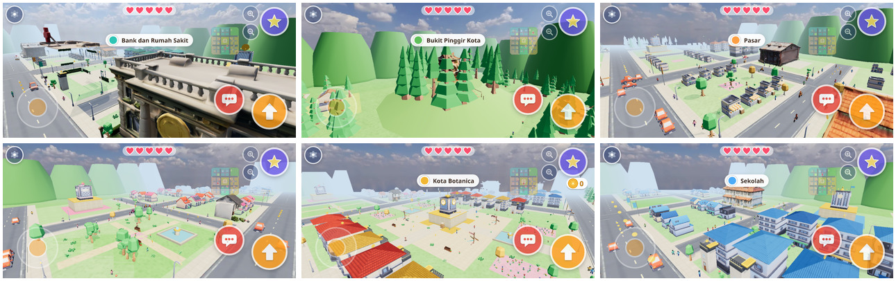
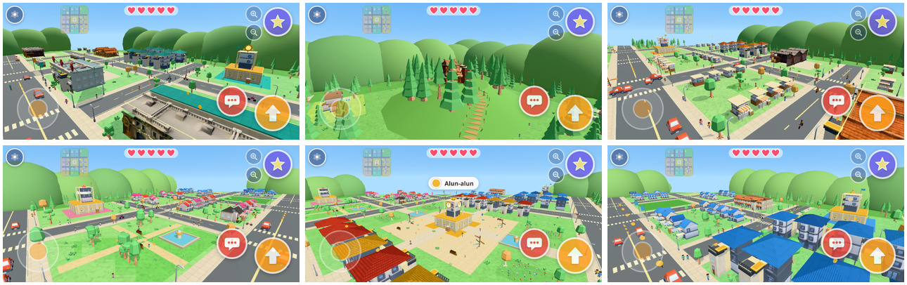
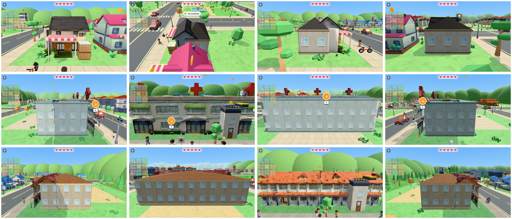
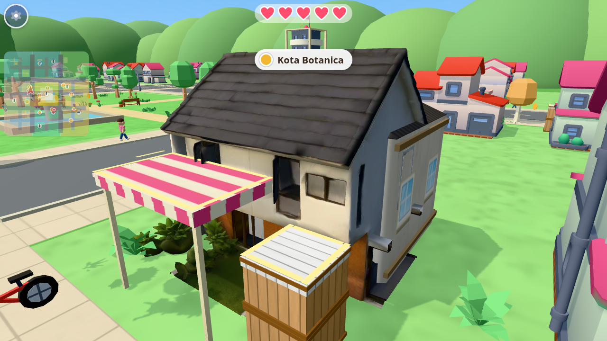
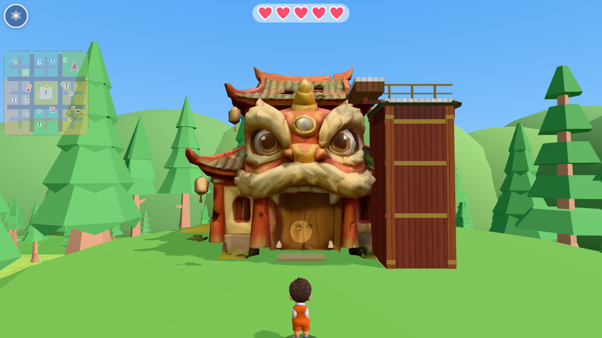

# C2 city look — review ready

The city now uses uniform model scaling, collider-aligned architecture and climbing supports, a brighter blue daylight sky, pastel district colours, Kenney road modules, detailed podiums and crossings, rounded distant hills, and friendlier round instanced pedestrians. The seven owner buildings remain in place; added side/end cladding closes the visible holes in the school, hospital, and Glen's house. The old Barongsai building keeps its complete lion face and door, with its climbing structure visibly supported.

Touch and desktop share the same daylight rendering. The touch minimap has moved clear of the joystick and laser control, and HUD checks cover the minimap, joystick, dialog, and both zoom buttons.

Review: [PR #24](https://github.com/arsenick04/superglen/pull/24), branch `codex/c2-city-look`.

## Before / after

Desktop views, ordered bank/hospital, hill, market, housing, plaza, school:

Close-up evidence:

Reproduce the views with a dev server running: `C2_PHASE=review node scripts/city-look-shots.cjs`.

## Validation

- `npm run build` — PASS
- `npm run check:reach` — PASS (0 errors, 0 warnings)
- `npm run check:quiz` — PASS
- Smoke groups, run one at a time: `kota`, `kota-touch`, `kota-life`, `hud-layout`, `hud-layout-touch`, and `bab1` — PASS
- Busiest reviewed desktop crowd view: 44 calls / 403,208 triangles, within the unchanged 70 / 480,000 budgets.

CityData, gameplay, story, and audio are unchanged in this PR.

## Open review items

- The added side/back cladding is intentionally simpler than the detailed front scans; joins can still be visible at close range.
- Facade modules repeat on unusually wide lots to avoid stretched geometry.
- Real-iPhone frame rate and final owner visual approval still require a physical-device review; headless Chromium is not a reliable iPhone performance measurement.
