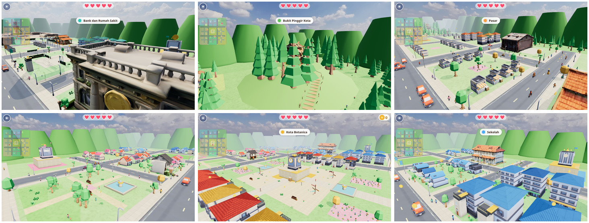
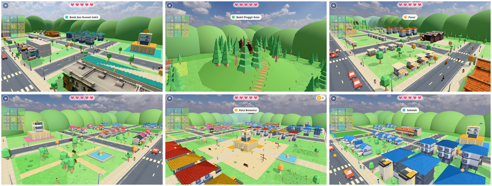

# C2 city look — work in progress

The city uses uniform model scaling, collider-aligned architectural supports, brighter daylight, detailed podiums and crossings, rounded distant hills, and rounder instanced pedestrians. Touch minimap placement and HUD checks include zoom controls.

Current validation: `npm run build` PASS; `npm run check:reach` PASS (0 errors, 0 warnings). CityData, gameplay, story and audio are unchanged.

Quiz validation and kota-touch PASS. The app now explicitly uses its existing logo as the favicon, fixing the missing favicon request. City rendering skips the extra GTAO/bloom chain to share the touch daylight pipeline.

Review: [PR #24](https://github.com/arsenick04/superglen/pull/24), branch `codex/c2-city-look`.

Latest reruns: `kota` PASS, `bab1` PASS, `kota-life` PASS. The busiest desktop crowd view now renders at 44 calls / 403,090 triangles, within the unchanged 70 / 480,000 budgets after removing the additional city post pass.

Touch hud-layout now PASS. Its exploration setup waits for the arrival greeting and the dialog's idle tail to finish; dialog measurement waits for the visible pop-in. This exposed a real map/laser overlap, fixed by moving the map to the upper left (164 px from the safe inset). All presence, bounds, overlap and 44 px zoom target assertions remain strict. Desktop hud-layout previously PASS; rerun after the shared test setup update is pending.

Reproduce the visual views with the dev server running: `C2_PHASE=review node scripts/city-look-shots.cjs`. It captures six identical city views plus a Barongsai close-up on desktop and touch, under `/tmp/c2-shots/review`.

## Before / after

Desktop views, ordered bank/hospital, hill, market, housing, plaza, school:

## Still open

- Final close-up review of all seven owner buildings, especially Barongsai door/lion-face and climbing attachments.
- Repeat affected smoke groups after the remaining visual edits, one group at a time.
- Verify final screenshots against the latest source; these contact sheets show the preceding visual iteration.
- Kenney road tile integration and richer near-ground detail need further review.
- Real iPhone performance and final owner visual approval remain unverified.
